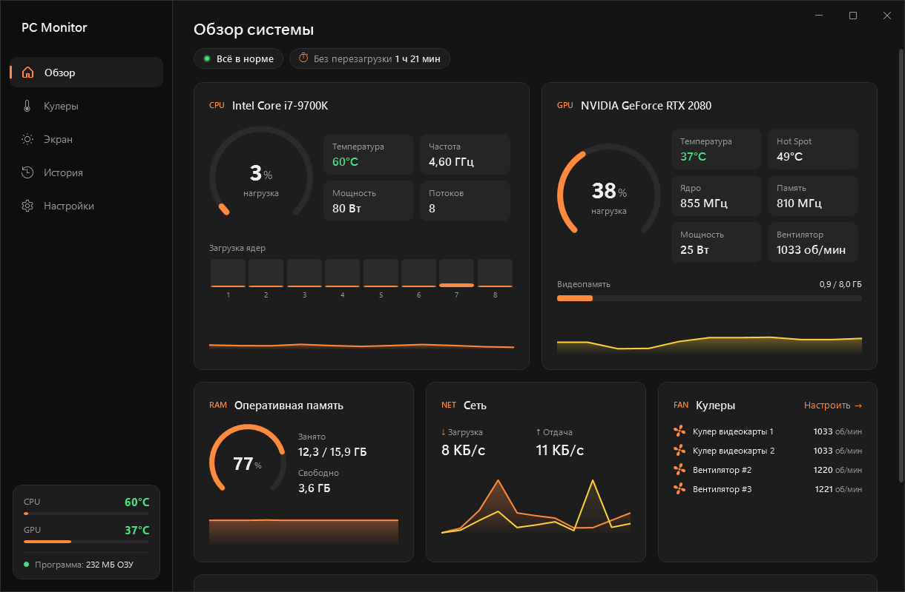
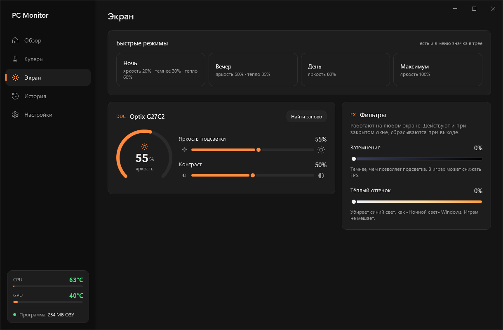
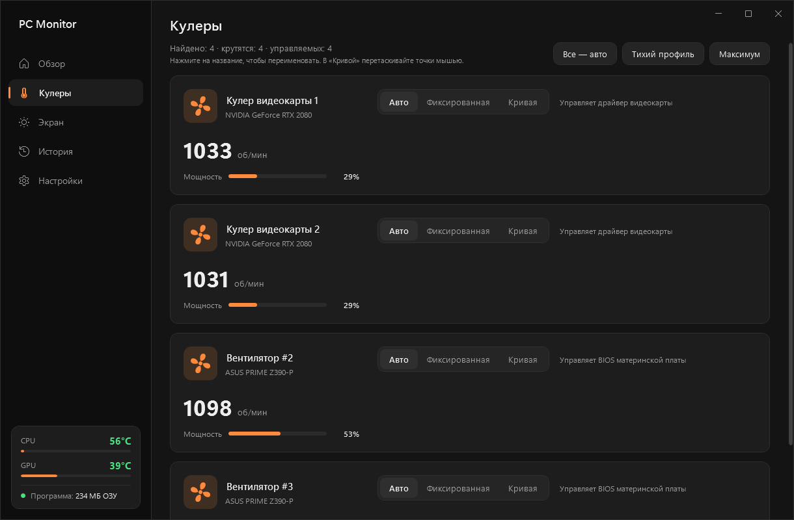
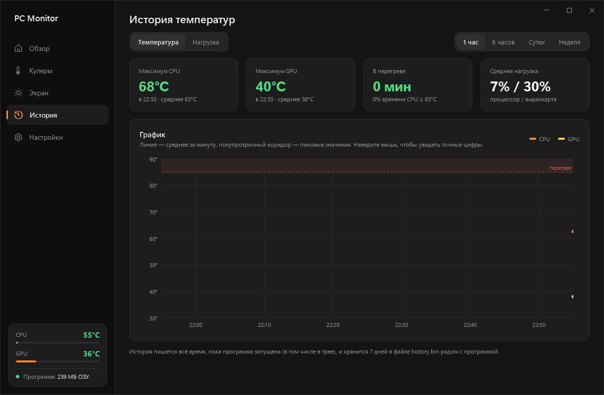
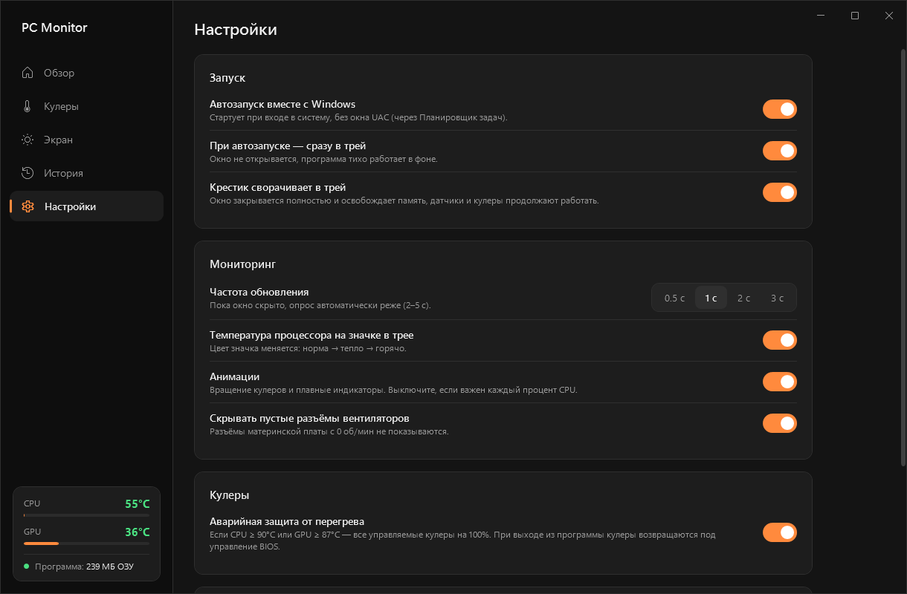

# PC Monitor

Лёгкий монитор системы для Windows: загрузка и температуры CPU/GPU, ОЗУ, сеть, диски,
обороты кулеров и управление ими (авто / фиксированная скорость / кривая по температуре),
история температур за неделю, яркость и контраст мониторов (DDC/CI), затемнение и тёплый оттенок экрана.

## Скриншоты

| Обзор | Экран |
|---|---|
|  |  |

| Кулеры | История |
|---|---|
|  |  |

| Настройки |
|---|
|  |

## Запуск

`dist\PCMonitor.exe` — требует прав администратора (без них не читаются датчики материнской платы).
Температура CPU и кулеры материнской платы доступны только с драйвером [PawnIO](https://pawnio.eu).

| Ключ | Что делает |
|---|---|
| `--tray` | старт сразу в трей (так запускает автозагрузка) |
| `--autostart-on` / `--autostart-off` | включить/выключить автозапуск и выйти |
| `--screenshots <префикс>` | инструмент разработчика: снять PNG каждой страницы и выйти |

Данные (`settings.json`, `history.bin`, `pcmonitor.log`) лежат рядом с exe,
а если туда нельзя писать — в `%LocalAppData%\PCMonitor`.

## Ресурсы

- В трее: ~25 МБ ОЗУ, ~0,2% CPU — окно при закрытии уничтожается целиком.
- С открытым окном: ~150 МБ ОЗУ, ~1% CPU.

## Безопасность кулеров

- Аварийный режим: CPU ≥ 90°C или GPU ≥ 87°C → все управляемые кулеры на 100%.
- При выходе, выключении Windows и необработанной ошибке кулеры возвращаются под управление BIOS/драйвера.
- При старте кулеры в режиме «Авто» принудительно сбрасываются — на случай, если прошлый запуск завершился аварийно.

## Разработка

```
.\build.ps1             # тесты + публикация в dist\
.\build.ps1 -SkipTests  # только публикация
dotnet build src\PCMonitor -p:AsInvoker=true   # отладочная сборка без UAC
```

Сборка строгая: все предупреждения компилятора и анализаторов — ошибки (`Directory.Build.props`, `.editorconfig`).

### Структура

```
src/PCMonitor/
  Hardware/     опрос датчиков (SensorReader), управление кулерами (FanController), фоновый цикл (HardwareMonitor)
  Core/         настройки, пороги температур, форматирование, история, лог — без зависимостей от UI
  Platform/     WinAPI, трей, автозапуск через Планировщик, единственный экземпляр
  Theming/      палитра приложения
  ViewModels/   по модели на страницу + корневая MainViewModel
  Views/        страницы (UserControl), без логики в code-behind
  Controls/     рисуемые элементы (кольцо, графики, редактор кривой) и поведения
  Converters/   конвертеры привязок
tests/PCMonitor.Tests/   xUnit: кривые, пороги, история, форматирование, конвертеры
tools/make-icon.ps1      генерация Assets/app.ico
```

Поток данных: `HardwareMonitor` (фоновый поток) → `Snapshot` → `TemperatureHistory` (сразу)
и `MainViewModel` (через Dispatcher, только пока окно открыто) → страницы.
Настройки кулеров пишутся из UI в `AppSettings`, откуда их читает `FanController` в потоке датчиков.

Датчики: [LibreHardwareMonitorLib](https://github.com/LibreHardwareMonitor/LibreHardwareMonitor) (MPL-2.0).
